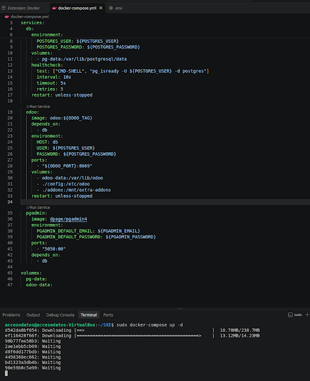
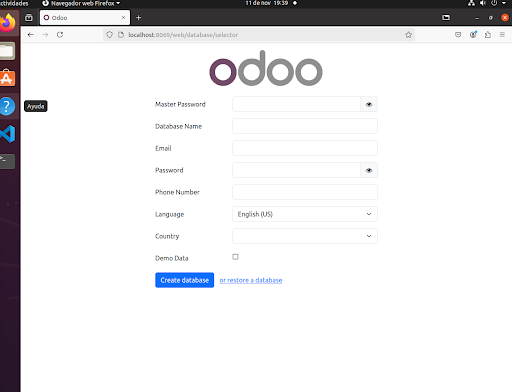
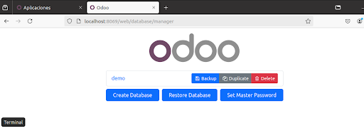
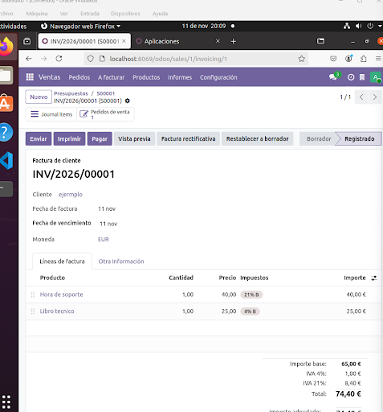
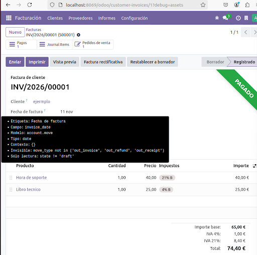
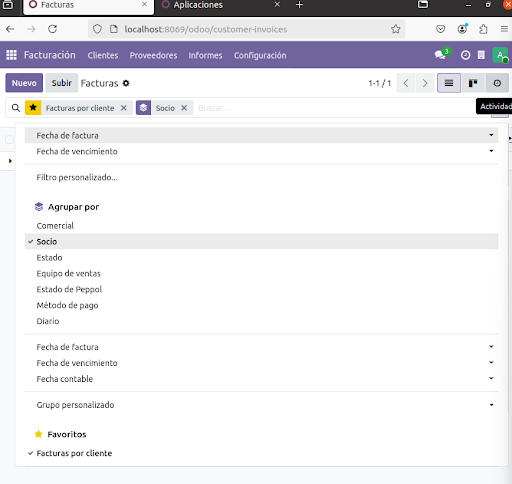
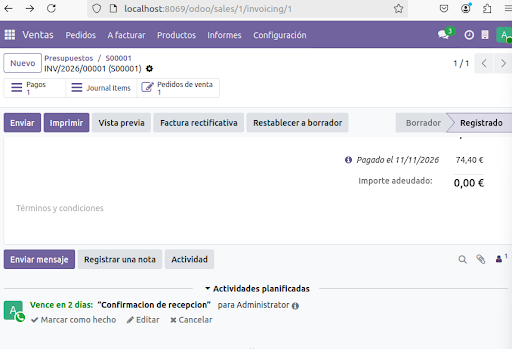
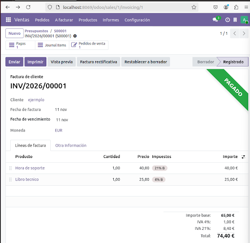

# Tarea 09: Configuración y Flujo Funcional en Odoo 19.0

**Asignatura:** Sistemas de Gestión Empresarial  
**Entorno:** Odoo 19.0 Community Edition (Docker / Linux Ubuntu)  
**Base de datos:** `real` (Localización Española)

---

## 1. Entorno y Configuración Inicial

Para la realización de esta práctica se desplegó una instancia local de Odoo 19.0 en un entorno dockerizado sobre un sistema operativo Linux Ubuntu en VirtualBox.

### Despliegue e Infraestructura

1. **Contenedor Docker (`docker-compose`)**: Se ejecutaron los servicios de Odoo 19.0 y PostgreSQL mediante la terminal de comandos (`docker-compose up -d`), exponiendo el servicio en el puerto $8069$.  
     
   *Figura 1: Ejecución del despliegue en contenedor con docker-compose up -d.*

2. **Inicialización de la Base de Datos**: Se accedió a `http://localhost:8069` para la creación y configuración inicial de la base de datos con localización española.  
     
   *Figura 2: Formulario inicial de creación de la base de datos.*

3. **Gestión de Bases de Datos**: Se verificó la administración de instancias en `/web/database/manager`.  
     
   *Figura 3: Panel del gestor de bases de datos de Odoo.*

### Configuración Fiscal y Módulos

* **Impuesto IVA General ($21\%$)**: Aplicado a servicios profesionales.
* **Impuesto IVA Superreducido ($4\%$)**: Aplicado a bienes como libros de texto.
* **Módulos Instalados**: `Ventas`, `Facturación`, `Inventario` y `Contactos`.

---

## 2. Desarrollo de Ejercicios Funcionales

### Ejercicio 1: Creación de Productos y Configuración de Impuestos

Se crearon dos productos representativos para evaluar el comportamiento del sistema según su naturaleza:

| Producto | Tipo de Producto | Precio de Venta | IVA Aplicado |
| :--- | :--- | :--- | :--- |
| **Hora de soporte** | Servicio | $40,00\ \text{€}$ | $21\%$ (Servicios) |
| **Libro técnico** | Consumible / Bien | $25,00\ \text{€}$ | $4\%$ (Superreducido) |

---

### Ejercicio 2: Flujo Comercial Completo (Presupuesto → Pedido → Factura → Pago → Chatter)

1. **Creación del Presupuesto (`S00001`)**: Se incluyeron ambos productos para el cliente (*ejemplo*), sumando una base imponible de $65,00\ \text{€}$ y un importe total con impuestos de $74,40\ \text{€}$.
2. **Confirmación a Pedido de Venta**: Tras seleccionar la dirección de contacto adecuada para resolver la ruta logística, el presupuesto pasó exitosamente al estado **Pedido de venta**.  
     
   *Figura 4: Presupuesto S00001 confirmado en estado Pedido de venta.*

3. **Facturación y Registro de Pago**:
   * Se generó y publicó la factura **`INV/2026/00001`**.
   * Se registró el pago completo por $74,40\ \text{€}$, pasando el documento al estado **PAGADO**.  
     
   *Figura 5: Factura INV/2026/00001 validada y registrada como PAGADO.*

4. **Gestión del Chatter**:
   * En el panel inferior de la factura se programó una actividad de tipo **Llamada** (*"Confirmacion de recepcion"*) asignada al Administrador.  
     
   *Figura 6: Actividad de llamada programada en el panel del Chatter.*

---

### Ejercicio 3: Filtros, Agrupación y Búsquedas Guardadas en Favoritos

1. En el listado de facturas de cliente (`Facturación > Clientes > Facturas`), se activó la vista en lista.
2. Se filtró por facturas en estado registrado/publicado y se aplicó el criterio de agrupación **Agrupar por: Socio** (Cliente).
3. Se guardó la vista dentro del menú desplegable **Favoritos** con el nombre **`Facturas por cliente`**.  
     
   *Figura 7: Listado de facturas agrupado por Socio y guardado en Favoritos.*

---

### Ejercicio 4: Modo Desarrollador e Inspección de Metadatos

1. Se activó el **Modo Desarrollador** desde la sección de *Ajustes* (verificado por el icono `🪲` y el parámetro `debug=assets` en la URL).
2. Se inspeccionaron los metadatos técnicos colocándose sobre la etiqueta del campo `Fecha de factura`:
   * **Etiqueta**: Fecha de factura
   * **Nombre técnico del campo**: `invoice_date`
   * **Modelo técnico**: `account.move`
   * **Tipo de dato**: `date`

  
*Figura 8: Tooltip flotante emergente con la información técnica (account.move / invoice_date).*

---

## 3. Resumen de Evidencias Fotográficas (`screenshots/`)

A continuación se lista la totalidad de las capturas guardadas en la carpeta `screenshots/` en orden cronológico del flujo de trabajo:

1. `01_despliegue_docker.png`: Traza de ejecución del despliegue en contenedor con `docker-compose up -d`.
2. `02_creacion_db.png`: Pantalla del asistente de creación de la base de datos en Odoo.
3. `03_gestor_db.png`: Panel `/web/database/manager` con el listado de bases de datos.
4. `04_pedido_confirmado.png`: Presupuesto `S00001` confirmado en estado *Pedido de venta*.
5. `05_factura_pagada.png`: Factura `INV/2026/00001` validada y con el sello diagonal *PAGADO*.
6. `06_chatter_actividad.png`: Actividad de llamada programada en el panel del Chatter de la factura.
7. `07_busqueda_favoritos.png`: Listado de facturas agrupado por Socio y guardado en *Favoritos*.
8. `08_modo_desarrollador.png`: Tooltip flotante emergente con la información técnica (`account.move` / `invoice_date`).

---

## 4. Declaración del Uso de Inteligencia Artificial

Durante el desarrollo de esta práctica se ha utilizado **Gemini** (Google AI) como asistente virtual y soporte técnico consultivo. Las aportaciones principales del modelo han sido:

* **Orientación funcional y navegación en Odoo 19.0**: Asesoramiento paso a paso para localizar opciones clave dentro de la interfaz (configuración de impuestos de IVA al $21\%$ y $4\%$, gestión de facturas, creación de actividades en el Chatter, aplicación de filtros con agrupaciones guardadas en Favoritos y activación del modo desarrollador).
* **Diagnóstico y resolución de errores**: Asistencia en la detección y corrección de bloqueos funcionales (como la gestión de rutas logísticas en presupuestos de venta) y la resolución de problemas con comandos en la terminal de Linux para el inicio de herramientas de desarrollo (Visual Studio Code).
* **Estructuración de la documentación**: Apoyo en la organización clara y profesional del informe técnico final en formato Markdown.